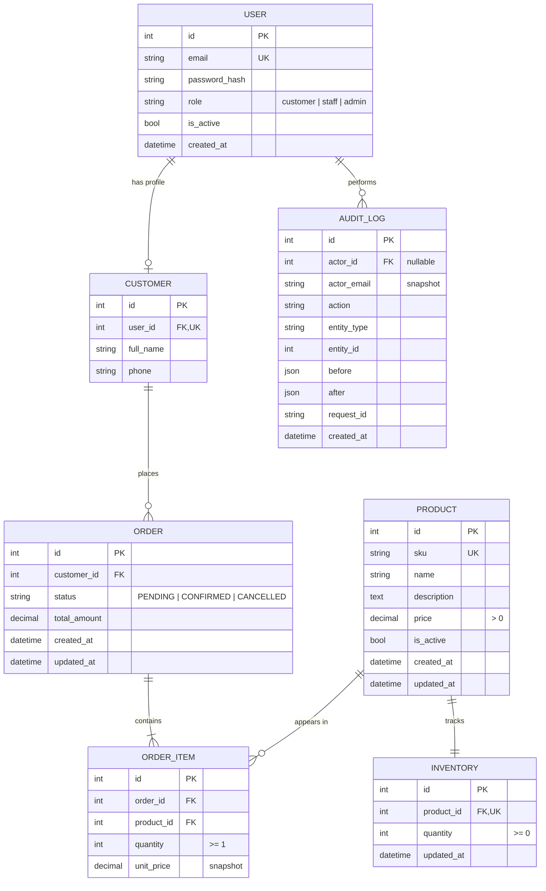

# 02 — Design: Secure Order Processing API

| | |
|---|---|
| **Author** | Cedrick Niyibikora |
| **Date** | 2026-10-07 |
| **Version** | 0.1 (draft) |
| **Implements** | Requirements in `01-requirements.md` |

---

## 1. Architecture overview

A single Django project exposing a versioned REST API (`/api/v1/`), backed by PostgreSQL.

```
Client (curl / Postman / Swagger UI)
        │  HTTPS + JWT
        ▼
Middleware (request ID, logging)
        ▼
DRF Views  →  Permissions (role check)  →  Serializers (validation)
        ▼
Service layer (business rules: place_order, cancel_order, adjust_stock)
        ▼
Django ORM  →  PostgreSQL
        ▲
Audit service (written in the same transaction as the change)
```

**Key principle:** views stay thin. Business rules (stock checks, status transitions, totals) live in **service functions** so they can be tested without HTTP.

---

## 2. Project layout

```
order-api/
├── config/                 # settings, urls
├── apps/
│   ├── accounts/           # User, Customer, auth endpoints, permissions
│   ├── catalog/            # Product, Inventory
│   ├── orders/             # Order, OrderItem, services
│   └── audit/              # AuditLog, record_audit(), request-ID middleware
├── core/                   # shared: exception handler, error codes
├── tests/
├── docs/
├── evidence/
├── requirements.txt
└── README.md
```

---

## 3. Data model



### Data rules (enforced in the database, not only in code)
- `Product.price > 0` (CheckConstraint)
- `Inventory.quantity >= 0` (CheckConstraint). This is the last line of defence against overselling.
- `OrderItem.quantity >= 1` (CheckConstraint)
- `OrderItem` unique on `(order, product)`
- `Product.sku` unique; `User.email` unique
- Money uses `DecimalField(max_digits=10, decimal_places=2)`, **never float**
- `OrderItem.product` uses `on_delete=PROTECT`. Products are deactivated, never deleted, so history stays intact.
- `AuditLog` keeps `actor_email` as a snapshot, so the log survives even if a user is removed.

---

## 4. Roles and permission matrix

| Action | customer | staff | admin |
|---|---|---|---|
| Register / log in | ✔ | ✔ | ✔ |
| List/view active products | ✔ | ✔ | ✔ |
| Create/update/deactivate products | ✘ | ✔ | ✔ |
| View/adjust inventory | ✘ | ✔ | ✔ |
| Place order | ✔ | ✔ | ✔ |
| View own orders | ✔ | ✔ | ✔ |
| View all orders | ✘ | ✔ | ✔ |
| Confirm order | ✘ | ✔ | ✔ |
| Cancel order | own only | any | any |
| Change a user's role | ✘ | ✘ | ✔ |
| Read audit log | ✘ | ✘ | ✔ |

---

## 5. API endpoints (`/api/v1`)

| Method | Path | Who | Success | Purpose |
|---|---|---|---|---|
| POST | `/auth/register` | public | 201 | Create customer account |
| POST | `/auth/login` | public | 200 | Get access + refresh tokens |
| POST | `/auth/refresh` | public | 200 | New access token |
| GET | `/me` | any | 200 | Own profile |
| PATCH | `/users/{id}/role` | admin | 200 | Change role |
| GET | `/products` | any | 200 | List active products (paginated, `?search=`) |
| GET | `/products/{id}` | any | 200 | Product detail |
| POST | `/products` | staff+ | 201 | Create product (+ inventory row) |
| PATCH | `/products/{id}` | staff+ | 200 | Update product |
| POST | `/products/{id}/deactivate` | staff+ | 200 | Hide product |
| GET | `/products/{id}/stock` | staff+ | 200 | View stock |
| POST | `/products/{id}/stock/adjust` | staff+ | 200 | Add/remove stock with reason |
| POST | `/orders` | any | 201 | Place order |
| GET | `/orders` | any | 200 | Own orders (staff+: all) |
| GET | `/orders/{id}` | any | 200 | Order detail |
| POST | `/orders/{id}/confirm` | staff+ | 200 | PENDING → CONFIRMED |
| POST | `/orders/{id}/cancel` | owner / staff+ | 200 | Cancel and restore stock |
| GET | `/audit-logs` | admin | 200 | Filter by `?entity_type=&actor=&date=` |
| GET | `/schema/` , `/docs/` | public | 200 | OpenAPI schema + Swagger UI |

### Example: place an order
**Request** `POST /api/v1/orders`
```json
{
  "items": [
    {"product_id": 1, "quantity": 2},
    {"product_id": 4, "quantity": 1}
  ]
}
```
**Success** `201`
```json
{
  "id": 17,
  "status": "PENDING",
  "total_amount": "45.50",
  "items": [
    {"product_id": 1, "name": "Rice 5kg", "quantity": 2, "unit_price": "15.00"},
    {"product_id": 4, "name": "Cooking oil 2L", "quantity": 1, "unit_price": "15.50"}
  ]
}
```
The client never sends a price or total. The server calculates both.

---

## 6. Error design

One shape for every error. The `message` is written in plain language for people. The `code` is for programs.

```json
{
  "error": {
    "code": "INSUFFICIENT_STOCK",
    "message": "Sorry, only 3 units of Rice 5kg are left. You asked for 5.",
    "details": {"product_id": 1, "available": 3, "requested": 5}
  }
}
```

| Situation | HTTP | `code` | Example message |
|---|---|---|---|
| Invalid input | 400 | `VALIDATION_ERROR` | "Quantity must be 1 or more." |
| Duplicate product in order (D2) | 400 | `DUPLICATE_PRODUCT` | "Rice 5kg appears twice (lines 1 and 3). Was this a mistake? Combine them into one line with quantity 4 and send again." |
| Missing/expired token | 401 | `NOT_AUTHENTICATED` | "Please log in to continue." |
| Wrong role | 403 | `PERMISSION_DENIED` | "Your account isn't allowed to do this." |
| Order not found, or not yours (D3) | 404 | `NOT_FOUND` | "We couldn't find that order on your account." |
| Not enough stock | 409 | `INSUFFICIENT_STOCK` | (see above) |
| Invalid status change | 409 | `INVALID_STATUS_TRANSITION` | "This order is already cancelled, so it can't be confirmed." |
| Unexpected server fault | 500 | `SERVER_ERROR` | "Something went wrong on our side. Please try again." (no stack trace) |

Implemented once, in a custom DRF exception handler (`core/exceptions.py`).

---

## 7. Core business flows

### 7.1 Place order (atomic)
```
1. Validate payload (items non-empty, quantities >= 1, product ids valid)
2. Detect duplicate product ids → return DUPLICATE_PRODUCT (D2)
3. BEGIN TRANSACTION
4.   Lock the Inventory rows for the requested products, ordered by product id
     (select_for_update; consistent order prevents deadlocks)
5.   For each item: if product inactive → error; if stock < quantity → INSUFFICIENT_STOCK
6.   Deduct stock for each item
7.   Create Order (PENDING) + OrderItems with unit_price snapshot; compute total
8.   Write audit entry (same transaction)
9. COMMIT   (any error before this point rolls back everything)
```

### 7.2 Cancel order
```
BEGIN TRANSACTION
  Lock the order row; check status is PENDING or CONFIRMED (else INVALID_STATUS_TRANSITION)
  Lock inventory rows; add quantities back
  Set status = CANCELLED
  Write audit entry
COMMIT
```

### 7.3 Status transitions (allowed set)
```
PENDING   → CONFIRMED
PENDING   → CANCELLED
CONFIRMED → CANCELLED
(everything else is rejected)
```

### 7.4 Audit
`record_audit(actor, action, entity, before, after)` is called **inside** the same transaction as the change, so a change and its audit entry either both exist or neither does. The audit table has no update/delete endpoints.

---

## 8. Security design

- Custom `User` model with email login, defined **before the first migration**
- Passwords hashed by Django (PBKDF2 by default); minimum length validated
- JWT access token 15 min, refresh token 1 day (SimpleJWT)
- Role checks in one place: reusable DRF permission classes (`IsStaff`, `IsAdmin`, `IsOrderOwnerOrStaff`)
- Order queries are filtered by owner for customers, so another customer's order simply isn't found (D3)
- `DEBUG=False` behaviour verified; secrets from environment variables (`.env`, not in Git)
- Input validated only through serializers; no raw SQL

---

## 9. Logging

- Middleware assigns a **request ID** to each request (returned in the `X-Request-ID` header)
- Each log line: timestamp, level, request ID, user id, method, path, status, duration
- Audit log (business events, in the database) is separate from application log (technical events, in a file or console)

---

## 10. Design decisions

| ID | Decision | Reason |
|---|---|---|
| D5 | Custom `User` model with email as login, set before first migration | Changing it later is painful |
| D6 | Business rules in service functions, not in views | Testable without HTTP; clean explanation in viva |
| D7 | Lock inventory rows with `select_for_update` inside a transaction | Prevents overselling under concurrency |
| D8 | URL versioning `/api/v1/` | Allows future non-breaking changes |
| D9 | Money as `Decimal`, never float | Avoids rounding errors |
| D10 | Products are deactivated, not deleted | Preserves order history |
| D11 | Audit entry written in the same transaction as the change | Change and record can never disagree |
| D12 | HTTP 409 for stock and status conflicts | Request is valid but conflicts with current state |

---

## 11. Known limitations (to disclose in the README)

- No payment handling; orders are not paid for
- Single warehouse, single currency
- Stock is reserved immediately, so abandoned `PENDING` orders hold stock until cancelled (a timeout job could be a future improvement)
- No email notifications